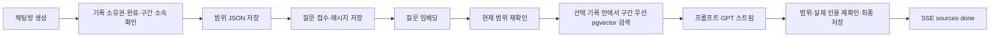

# 모바일 합의 반영: 채팅·폴더 API

2026-11-11 합의에 따른 백엔드 구현이다. 로그인 제외 데모의 서버 고정 사용자 구분은 유지한다. 실제 모바일 연결·GCS 왕복·GPT 응답 품질을 검증했다는 의미는 아니다.

## 영상·구간 채팅

Chat 서버의 `POST /api/v1/conversations`에 UUID `Idempotency-Key`와 JSON 본문을 보낸다.

```json
{
  "scope": {
    "type": "RECORD",
    "recordId": "30111111-1111-4111-8111-111111111111",
    "focusSectionId": "70111111-1111-4111-8111-111111111111"
  }
}
```

- 영상 전체 채팅은 focusSectionId를 생략하거나 null로 전달한다. recordId는 개인 분석 기록 ID이며 videoId·analysisId와 다르다.
- RECORD는 folderId·keywordIds·q 필터와 함께 사용할 수 없다. ALL/FILTERED에서는 recordId·focusSectionId를 보내지 않는다.
- 본인 소유의 완료·chatReady 기록만 사용한다. 구간은 같은 분석 결과의 JSON과 analysis_sections에 모두 있어야 한다.
- 성공은 HTTP 201과 Location. 기존 응답의 conversationId·scope·scopeLabel·recordCount를 사용한다. RECORD의 recordCount는 1이다. 새 선택 필드가 null이면 응답에서 생략할 수 있다.
- 잘못된 필드 조합은 400 INVALID_REQUEST. 타인·삭제·없는 기록, 미완료 기록, 소속이 다른 구간은 404 RESOURCE_NOT_FOUND. 기존 범위를 사용할 수 없게 된 방의 신규 질문은 409 SCOPE_UNAVAILABLE다.
- 범위를 바꾸면 새 키로 새 방을 만든다. 동일 키·동일 본문은 기존 방을 반환하며 다른 본문 재사용은 409 IDEMPOTENCY_CONFLICT다. 기존 ALL/FILTERED 방·키도 유지한다.



구간 우선 검색은 선택 구간과 겹치는 원문을 먼저, 그다음 같은 영상의 다른 구간을 코사인 거리순으로 찾는다. 선택 구간의 모든 원문 또는 앞뒤 구간이 반드시 포함된다는 보장은 없다. topK·문자·토큰 예산은 기존 값을 유지한다. 다른 개인 기록·타인 기록을 섞지 않고 기존 원문·벡터를 재사용한다.

원본 기록 삭제 후 방 상세의 scopeStatus는 UNAVAILABLE, recordCount는 0이다. 기존 대화는 조회 가능하며 삭제된 출처의 availability는 DELETED다. 생성 도중 기록·구간을 사용할 수 없게 되면 성공 done을 보내지 않고 기존 실패/부분 답변 규칙으로 저장한다.

읽기 시작점: `ChatScope` → `ChatScopeQuery.resolveRecord()` → `ChatGenerationStore.begin()/refresh()` → `ChatContextQuery.search()` → `ChatGenerationStore.complete()`.

## 폴더 이름

`POST /api/v1/folders`, `PATCH /api/v1/folders/{folderId}`의 본문은 동일하다. 생성에는 기존 UUID Idempotency-Key가 필요하다.

```json
{ "name": "AI  공부-노트" }
```

| 규칙 | 처리 |
| --- | --- |
| 앞뒤 공백 | 제거 후 저장·검증 |
| 내부 공백·하이픈·대소문자 | 입력 그대로 저장·표시 |
| 길이 | 빈 이름 금지, 최대 20 Unicode 코드 포인트. 앱 글자 수도 `Array.from(trimmedName).length` 기준 |
| 중복 | 같은 사용자 안에서 ASCII 영문 A–Z 대소문자만 무시. 내부 공백·하이픈은 구분 |
| 이름 변경 | 자기 폴더는 중복 검사에서 제외. 대소문자만 바꾸기 허용 |
| 동시 요청 | 기존 사용자 잠금 + DB unique index로 중복 방지 |

이름 오류는 400 INVALID_REQUEST, 중복은 HTTP 409다. 프론트는 입력을 유지하고 필드 아래 오류를 표시한다.

```json
{
  "code": "FOLDER_NAME_DUPLICATED",
  "message": "이미 사용 중인 폴더 이름이에요."
}
```

V8 마이그레이션은 기존 폴더에 20자 초과나 사용자별 중복이 있으면 적용을 중단한다. 폴더·연결을 자동 삭제하거나 이름을 자르지 않는다. 로컬 DB에서 해당 이름을 수동 조정한 뒤 다시 실행한다. API가 먼저 Flyway를 적용하고 Worker·Chat을 실행한다.

## 폴더에 기록 추가

`POST /api/v1/folders/{folderId}/records` → HTTP 200. [노션 ARCHIVE-10](https://app.notion.com/p/40c46c2fafdf81f99414f8027bccc664)의 응답을 따른다.

```json
{
  "recordIds": [
    "30111111-1111-4111-8111-111111111111",
    "30222222-2222-4222-8222-222222222222"
  ]
}
```

```json
{
  "code": "OK",
  "message": "요청이 완료됐어요.",
  "data": {
    "folderId": "21111111-1111-4111-8111-111111111111",
    "addedRecordIds": ["30111111-1111-4111-8111-111111111111"],
    "alreadyIncludedRecordIds": ["30222222-2222-4222-8222-222222222222"],
    "recordCount": 5
  }
}
```

recordCount는 처리 후 폴더 전체 기록 수다. 요청 개수를 더하지 않고 응답 값으로 화면을 갱신한다. 중복 입력·이미 연결된 기록은 새 연결을 만들지 않는다. 타인·없는 기록이 있으면 전체 요청을 거절하며 다른 폴더의 연결은 유지한다.

## 이번 PR 이후 모바일 작업

- RECORD·focusSectionId 요청 연결, 범위 변경 시 새 채팅방 생성.
- 폴더 이름 자동 치환 제거, 서버와 같은 길이·중복 오류 표시, 기록 추가 후 recordCount 반영.
- 기기 전체 수집 제한, batchId 저장·사용자 수집 재개, 재시도 가능한 분석 실패 버튼.
- 관련 영상 추천은 MVP에서 보류하고 진입·API 호출을 중지.
- 네이티브 수집의 원문·시간·순서·반복 문장 보존. 백엔드 CaptionParser는 원문과 시간 겹침을 보존한다.

기존 분석 재시도 API·배치 상태 조회를 사용한다. 서버 yt-dlp 수집·자동 수집 재개·새 추천 API를 추가하지 않는다. 수집 간격과 RAG 검색 품질 파라미터는 실제 기기·영상 평가 후 조정한다.
